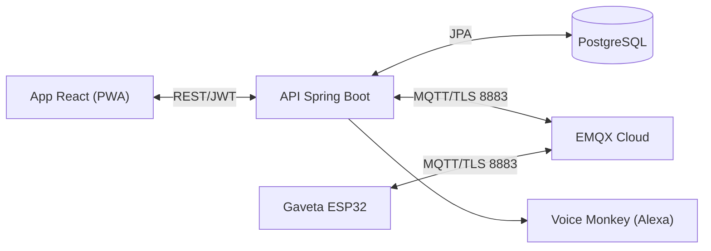

# RemedIoT

Sistema de monitoramento de adesão medicamentosa (TCC). Aplicativo web (PWA) para
cuidadores acompanharem o uso de medicamentos por pacientes, integrado por MQTT a um
dispositivo IoT (gaveta inteligente com ESP32).

> **Nota científica:** o sistema detecta a *abertura do compartimento* (interação), não a
> ingestão do medicamento.

## Stack

| Camada     | Tecnologia                                   |
|------------|----------------------------------------------|
| Frontend   | React + Vite (PWA)                           |
| Backend    | Java 17 + Spring Boot (Maven)               |
| Banco      | PostgreSQL                                    |
| Auth       | E-mail e senha (JWT), perfis Cuidador/Paciente |

## Estrutura do projeto

```
remediot/
├── CLAUDE.md                  # contexto e regras (lido pelo Claude Code)
├── README.md                  # este arquivo
├── PROMPT-INICIAL.md          # plano de construção em fases
├── CHECKLIST-FINALIZACAO.md   # guia para fechar o TCC
├── frontend/                  # React + Vite (PWA)
└── backend/                   # Spring Boot (Java 17 + Maven)
```

## Pré-requisitos

Instale (uma vez):

- **Node.js 18+** — https://nodejs.org (você já tem)
- **JDK 17+** — Temurin/Adoptium: https://adoptium.net
- **Maven 3.9+** — https://maven.apache.org (ou use o wrapper `./mvnw` que o Spring gera)
- **PostgreSQL 15+** — https://www.postgresql.org/download/
  - Alternativa mais simples: rodar via Docker (comando abaixo).

Verifique as versões:

```bash
node -v
java -version
mvn -v      # ou ./backend/mvnw -v
```

## Banco de dados (Docker — opção mais fácil)

```bash
docker run --name remediot-db -e POSTGRES_PASSWORD=remediot \
  -e POSTGRES_DB=remediot -p 5432:5432 -d postgres:16
```

No `backend/src/main/resources/application.properties` aponte para:

```
spring.datasource.url=jdbc:postgresql://localhost:5432/remediot
spring.datasource.username=postgres
spring.datasource.password=remediot
spring.jpa.hibernate.ddl-auto=update
```

## Rodando o projeto

**Backend** (porta 8080):

```bash
cd backend
./mvnw spring-boot:run
```

**Frontend** (porta 5173):

```bash
cd frontend
npm install
npm run dev
```

Abra http://localhost:5173.

## Gaveta (ESP32) por MQTT

A gaveta conversa só por MQTT, com TLS, no EMQX Cloud. O backend Spring assina e publica
direto no broker (Spring Integration MQTT), sem Node-RED. O formato de todas as mensagens
está em [`docs/gaveta/CONTRATO-MQTT.md`](docs/gaveta/CONTRATO-MQTT.md). Ele não muda sem
combinar com quem cuida do firmware.



| Tópico `remediot/v1/{deviceId}/…` | Direção | Para quê |
|---|---|---|
| `eventos` | gaveta → API | Aberturas e alertas; viram doses `TOMADA`/`ATRASADA`/`NAO_RETIRADA` |
| `eventos/confirmacao` | API → gaveta | Confirma cada evento depois de gravar |
| `status` | gaveta → API | Heartbeat a cada 60 s e LWT (offline) |
| `config/agenda` | API → gaveta | Agenda (retained): uma entrada por horário, sem nome de remédio |
| `comando` | API → gaveta | Reabastecer, localizar, silenciar, "fui eu", trocar Wi-Fi... |
| `ack` | gaveta → API | Resposta aos comandos e à agenda |

As regras de horário das doses são as do app (`DoseStatusService`). O status de uma
abertura vinda da gaveta é calculado com o horário real em que ela foi aberta.

### Ligando o MQTT

O MQTT vem **desligado**. Sem ele, o app sobe sem broker e o que seria publicado vai só
para o log. Para ligar, defina as variáveis no PowerShell antes de subir o backend. A senha
vem por mensagem privada e **nunca** entra no Git:

```powershell
$env:MQTT_ENABLED = "true"
$env:MQTT_HOST = "<endereço da deployment do EMQX>"
$env:MQTT_PORTA = "8883"
$env:MQTT_USUARIO = "remediot-backend"   # usuário do BACKEND, não o da gaveta
$env:MQTT_SENHA = "<senha do remediot-backend>"
$env:MQTT_CLIENT_ID = "remediot-backend-lucas"   # um diferente por máquina
cd backend
./mvnw spring-boot:run
```

No log deve aparecer `MQTT ligado: ssl://...:8883`. O certificado do EMQX (DigiCert) já é
reconhecido pelo Java, então não é preciso configurar certificado.

> Se a `ponte-app/` provisória (Node.js) estiver rodando, **desligue-a** antes de ligar o
> MQTT no backend. As duas juntas publicam agendas com `doseId` diferentes.

### Como conectar a gaveta

1. O cuidador abre a tela do paciente → card **Gaveta** → **Conectar gaveta**.
2. Liga a gaveta na tomada (a luz pisca em branco).
3. No celular, conecta na rede `RemedIoT-XXXX` com a senha do portal
   (`VITE_GAVETA_SENHA_PORTAL` no `.env` do frontend).
4. Na página da gaveta (abre sozinha, ou `192.168.4.1`), escolhe o Wi-Fi da casa e digita
   a senha dele. Essa senha é digitada **na gaveta**, não no app.
5. Volta para a internet normal e digita no app os 4 caracteres do nome da rede (ex.: `C4D5`).
   O app acompanha até a gaveta ficar online e confirmar a agenda.

Com gaveta vinculada, o botão "Simular abertura da gaveta" some para aquele paciente.

### Testando sem a gaveta

Com o MQTT ligado, use o **Online Test** do console do EMQX (ou o MQTTX) com o usuário do
backend e publique, por exemplo:

- em `remediot/v1/A4CF12B3C4D5/status`, um heartbeat (`{"online":true,"deviceId":"A4CF12B3C4D5",...}`).
  A gaveta aparece aguardando pareamento, e o código no app é `C4D5`;
- em `remediot/v1/A4CF12B3C4D5/eventos`, um evento `DOSE_CONFIRMADA` com `dados.doseId` =
  `"s"` + id do horário (aparece na agenda publicada em `config/agenda`).

Há JSONs reais do firmware em `docs/gaveta/backend-exemplo/src/test/resources/firmware/`,
e o `docs/gaveta/ROTEIRO-DE-TESTES.md` mostra o que a gaveta manda em cada situação. O
teste `FirmwareContractTest` lê esses JSONs em modo estrito: se o contrato mudar de um
lado só, o teste quebra.

## Dados de exemplo

Na primeira execução com o banco vazio, o backend cria automaticamente um cuidador de
demonstração e 4 pacientes com medicamentos variados (ver `remediot.seed.enabled` em
`application.properties`, ligado por padrão):

- **Cuidador:** `cuidadora@remediot.com.br` / `demo1234`
- Os 4 pacientes (Maria, Antônio, Rosa, Carlos) usam a mesma senha `demo1234`, com e-mails
  no formato `nome.sobrenome@remediot.com.br` (ver `SeedDataRunner`).

Para começar com o banco vazio (sem os dados de exemplo), defina `SEED_ENABLED=false`.

## Como construir com o Claude Code

1. Crie a pasta `remediot/` e coloque dentro os quatro `.md` deste pacote.
2. Abra o VS Code nessa pasta e inicie o Claude Code (`claude` no terminal integrado).
3. Ele lê o `CLAUDE.md` sozinho. Se sugerir, rode `/init`.
4. Abra o `PROMPT-INICIAL.md` e cole os blocos, **fase por fase**.
5. Ao fim de cada fase que funcionar, faça `git commit` para ter pontos de retorno.

## Roadmap

- [x] Definição de escopo e arquitetura
- [x] App completo com simulador de sensor
- [ ] Impressão 3D e montagem da gaveta (ESP32 + sensor magnético + buzzer)
- [x] Integração ESP32 → MQTT (EMQX Cloud) → API, sem Node-RED (ver "Gaveta (ESP32) por MQTT")
- [x] Lembretes por voz na Alexa (Voice Monkey)
- [ ] Alertas por WhatsApp
- [ ] Evolução: sensor de peso para maior precisão
