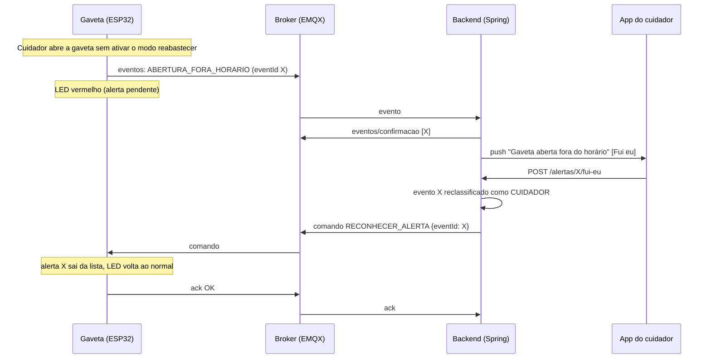

# Contrato MQTT — RemedIoT v1

Este documento define tudo o que trafega entre a gaveta (ESP32) e o backend (Spring Boot). O firmware e os `record`s Java do exemplo seguem exatamente este contrato. Os JSONs abaixo foram tirados da saída real do firmware rodando no simulador.

> **Mudanças na revisão do firmware 2.2.0** (nenhuma quebra o que já existia):
> - novo `motivo` no status offline: `TROCANDO_WIFI` (seção 6);
> - `eventId` não recomeça em 1 depois de apagar a flash (seção 4.1);
> - versão da agenda: usar o horário da alteração em segundos; agenda de até 7.500 bytes (seção 7);
> - remédio removido da agenda para de tocar na hora (seção 7).

## 1. Visão geral

| Item | Valor |
|---|---|
| Broker | EMQX Cloud Serverless (gratuito). O firmware também aceita o HiveMQ Cloud, cujo plano gratuito foi encerrado |
| Conexão | TLS na porta **8883**, usuário e senha |
| Credenciais | Uma para os **dispositivos** e outra para o **backend** |
| Identificador do aparelho | `deviceId` = 12 hexadecimais do MAC, ex.: `A4CF12B3C4D5` |
| Prefixo dos tópicos | `remediot/v1/{deviceId}/`. O `v1` permite mudar o formato no futuro sem quebrar os aparelhos antigos |
| Formato | JSON UTF-8, nomes de campo em camelCase |
| Horário | `ts` é sempre **epoch UTC em segundos**. O fuso (São Paulo, UTC−3) só é aplicado na hora de mostrar |

**Por que a confirmação existe.** A biblioteca do ESP32 (PubSubClient) só publica em QoS 0, que não tem garantia de entrega. Por isso o firmware guarda cada evento numa fila em flash e só o apaga quando o backend confirma que recebeu. O resultado é entrega "pelo menos uma vez", e o `eventId` permite descartar as duplicatas.

## 2. Tópicos

| Tópico (`remediot/v1/{deviceId}/…`) | Direção | QoS | Retained | Conteúdo |
|---|---|---|---|---|
| `eventos` | ESP → backend | 0 | não | Eventos (seção 4) |
| `eventos/confirmacao` | backend → ESP | 1 | **não** | Confirmação de recebimento (seção 5) |
| `status` | ESP → backend | 0 (LWT: 1) | **sim** | Heartbeat, LWT e despedida (seção 6) |
| `config/agenda` | backend → ESP | 1 | **sim** | Agenda de doses (seção 7) |
| `comando` | backend → ESP | 1 | **não, nunca** | Comandos (seção 8) |
| `ack` | ESP → backend | 0 | não | Resposta a comandos e à agenda (seção 9) |

O backend assina `remediot/v1/+/eventos`, `remediot/v1/+/status` e `remediot/v1/+/ack`. O ESP assina só os três tópicos dele: `comando`, `config/agenda` e `eventos/confirmacao`.

## 3. Entrega dos eventos (fila offline)

1. O ESP cria o evento, dá um `eventId` e grava na flash (LittleFS) antes de qualquer coisa.
2. Com conexão, publica os eventos mais antigos primeiro, até 10 aguardando confirmação ao mesmo tempo.
3. O backend grava o evento e publica a confirmação com o `eventId`.
4. O ESP apaga o evento da fila. Se a confirmação não chegar em **60 s**, publica de novo com `"reenvio": true`.
5. Sem internet, os eventos se acumulam (até **200**, ou menos se a flash encher antes). Se passar disso, o mais antigo é descartado e a contagem aparece em `filaDescartados` no status.

O reenvio mantém o `ts` original, ou seja, o momento em que a coisa aconteceu, e não o momento do envio.

## 4. Eventos

### 4.1 Envelope (igual para todos)

```json
{
  "eventId": "A4CF12B3C4D5-00000007",
  "deviceId": "A4CF12B3C4D5",
  "tipo": "DOSE_CONFIRMADA",
  "ts": 1790291342,
  "fonteHora": "NTP",
  "uptimeMs": 120360,
  "boot": 1,
  "fw": "2.2.0-mvp",
  "reenvio": false,
  "dados": {
    "doseId": "s17",
    "dataReferencia": "2026-09-24",
    "horaPrevista": "08:00",
    "horarioPrevisto": 1790247600,
    "peso": 3,
    "atrasoSeg": 120,
    "alarmeSilenciado": false
  }
}
```

| Campo | Tipo | Descrição |
|---|---|---|
| `eventId` | string | `{deviceId}-{contador de 8 dígitos}`. Único e nunca repetido, mesmo após reinício. **Chave de idempotência**. A numeração pode ter buracos e, se a flash do ESP for apagada, recomeça num número sorteado (nunca em 1), para não repetir `eventId`s que o backend já gravou |
| `deviceId` | string | Tem que ser igual ao do tópico. O backend descarta o evento se não for |
| `tipo` | string | Ver 4.3. Um tipo desconhecido não pode quebrar o backend (firmware mais novo) |
| `ts` | número ou `null` | Epoch UTC em segundos. `null` quando o ESP não tinha hora (ver abaixo) |
| `fonteHora` | string | `NTP` ou `NENHUMA` |
| `tsEstimado` | boolean, opcional | `true` quando o `ts` foi calculado depois do evento (ver abaixo) |
| `uptimeMs` | número | Milissegundos desde que o ESP ligou |
| `boot` | número | Contador de inicializações do aparelho |
| `fw` | string | Versão do firmware |
| `reenvio` | boolean | `true` se esta publicação é repetição |
| `dados` | objeto | Específico de cada tipo (4.3) |

**Eventos sem hora.** Sem RTC no MVP, se o ESP reiniciar sem internet ele fica sem hora até o NTP responder. Os eventos criados nesse intervalo saem com `ts: null`. Se a hora chegar antes do envio, no mesmo boot, o ESP calcula o horário real pelo `uptimeMs`, preenche o `ts` e marca `"tsEstimado": true`. Se ainda assim vier `null`, o backend usa o horário de chegada.

### 4.2 Regras de horário (iguais às do app, por enquanto)

O firmware segue as mesmas regras do `DoseStatusService` do app. O grupo ainda vai rever esses valores; quando mudarem, mudam no `config.h` do firmware e no backend ao mesmo tempo.

| Momento (em relação ao horário da dose) | O que a gaveta faz | Evento | Status no app |
|---|---|---|---|
| Abriu de 30 min antes até o horário | Registra | `DOSE_ANTECIPADA` | `TOMADA` |
| Chegou o horário | LED azul piscando (sem som) | `ALARME_INICIADO` | continua `AGENDADA` |
| Abriu até 30 min depois | Registra | `DOSE_CONFIRMADA` | `TOMADA` |
| Passaram 30 min sem abrir | LED vermelho; peso 2 e 3: buzzer por 30 min | `DOSE_EM_ATRASO` | continua `AGENDADA` (é o momento de disparar o escalonamento "atrasado" do app) |
| Abriu depois dos 30 min e até 3 h | Registra | `DOSE_ATRASADA` | `ATRASADA` |
| Passaram 3 h sem abrir | LED vermelho | `DOSE_PERDIDA` | `NAO_RETIRADA` |

Regras que valem junto com a tabela:

- **Cada entrada da agenda é uma dose** (um remédio num horário, como o `MedicationSchedule` do app). Os eventos de dose vêm um por remédio.
- **Uma abertura vale para todas as doses no prazo.** A gaveta não sabe qual remédio saiu: se às 08:05 há dois remédios das 08:00 e um das 08:20, a mesma abertura gera `DOSE_CONFIRMADA` para os dois primeiros e `DOSE_ANTECIPADA` para o terceiro.
- **Peso e som (igual ao app):** no horário a gaveta só pisca o LED, porque o lembrete de voz é da Alexa. O alarme sonoro só entra quando a dose atrasa, e só para peso 2 e 3. Para voltar a apitar no horário, basta mudar `BUZZER_NO_HORARIO` no `config.h`.

Dois pontos em que a gaveta não copia o app ao pé da letra, porque não tem como saber de qual dose é a abertura:

- Abrir **mais de 30 min antes** não vira `ATRASADA` (como no app): vira `ABERTURA_FORA_HORARIO`.
- Abrir **depois das 3 h** não transforma a `NAO_RETIRADA` em `ATRASADA`: vira `ABERTURA_FORA_HORARIO`.

### 4.3 Tipos e `dados`

Campos comuns aos eventos de dose: `doseId`, `dataReferencia` (data local da dose), `horaPrevista` (`HH:mm` local), `horarioPrevisto` (epoch UTC) e `peso` (1, 2 ou 3).

| Tipo | Quando | Alerta ao cuidador? |
|---|---|---|
| `DISPOSITIVO_INICIADO` | Ao ligar | não |
| `ALARME_INICIADO` | Chegou o horário da dose | não |
| `DOSE_ANTECIPADA` | Gaveta aberta até 30 min antes do horário | não |
| `DOSE_CONFIRMADA` | Gaveta aberta até 30 min depois do horário | não |
| `DOSE_EM_ATRASO` | Passaram 30 min sem abertura | **sim** (escalonamento por peso) |
| `DOSE_ATRASADA` | Gaveta aberta entre 30 min e 3 h depois do horário | não |
| `DOSE_PERDIDA` | Passaram 3 h sem abertura (app: `NAO_RETIRADA`) | **sim** |
| `ALARME_SILENCIADO` | O app silenciou o alarme sonoro | não |
| `ABERTURA_FORA_HORARIO` | Abertura sem dose no prazo e fora do modo reabastecer | **sim** |
| `POSSIVEL_DOSE_DUPLA` | Nova abertura na tolerância de uma dose já registrada | **sim** |
| `ABERTURA_NAO_CLASSIFICADA` | Abertura sem hora confiável | não |
| `GAVETA_ESQUECIDA_ABERTA` | Gaveta aberta há mais de 5 min | **sim** |
| `GAVETA_FECHADA_APOS_ALERTA` | Fechou depois do alerta de gaveta esquecida | não |
| `REABASTECIMENTO` | Abertura durante o modo reabastecer | não |
| `MODO_REABASTECER_INICIADO` | Modo reabastecer ativado | não |
| `MODO_REABASTECER_ENCERRADO` | Modo reabastecer terminou | não |
| `FALHA_RELOGIO` | Ligou e ficou 2 min sem hora (doses suspensas) | **sim** |
| `RELOGIO_RESTABELECIDO` | A hora chegou depois de uma `FALHA_RELOGIO` | não |

**`DISPOSITIVO_INICIADO`**
```json
{ "motivoReset": "POWERON", "descricao": "Ligado na energia", "fw": "2.2.0-mvp", "agendaVersao": 7, "modoDemo": false }
```
Valores de `motivoReset`: `POWERON` (inclui o botão EN), `EXT`, `SW` (comando `REINICIAR`), `PANIC`, `INT_WDT`, `TASK_WDT` (watchdog: algo travou), `WDT`, `BROWNOUT`, `DEEPSLEEP` e `DESCONHECIDO`. `BROWNOUT` costuma indicar queda de tensão, por exemplo na troca da tomada para o power bank.

**`ALARME_INICIADO`**
```json
{ "doseId": "s17", "dataReferencia": "2026-09-24", "horaPrevista": "08:00", "horarioPrevisto": 1790247600, "peso": 3, "sonoro": false }
```
`sonoro` diz se a gaveta apita no horário (hoje `false`, igual ao app).

**`DOSE_ANTECIPADA`**
```json
{ "doseId": "s17", "dataReferencia": "2026-09-24", "horaPrevista": "08:00", "horarioPrevisto": 1790247600, "peso": 3, "antecedenciaSeg": 1200 }
```

**`DOSE_CONFIRMADA`**
```json
{ "doseId": "s17", "dataReferencia": "2026-09-24", "horaPrevista": "08:00", "horarioPrevisto": 1790247600, "peso": 3, "atrasoSeg": 300, "alarmeSilenciado": false }
```

**`DOSE_EM_ATRASO`**
```json
{ "doseId": "s17", "dataReferencia": "2026-09-24", "horaPrevista": "08:00", "horarioPrevisto": 1790247600, "peso": 3, "motivo": "SEM_ABERTURA", "alarmeSonoro": true }
```
`alarmeSonoro` diz se a gaveta começou a apitar pelo atraso (peso 2 e 3). O `motivo` pode ser:
- `SEM_ABERTURA`: o horário passou com o aparelho funcionando e ninguém abriu.
- `DISPOSITIVO_INDISPONIVEL`: o aparelho estava desligado ou sem hora no horário da dose.

**`DOSE_ATRASADA`**
```json
{ "doseId": "s17", "dataReferencia": "2026-09-24", "horaPrevista": "08:00", "horarioPrevisto": 1790247600, "peso": 3, "atrasoSeg": 5400, "alarmeSilenciado": false }
```

**`DOSE_PERDIDA`**
```json
{ "doseId": "s17", "dataReferencia": "2026-09-24", "horaPrevista": "08:00", "horarioPrevisto": 1790247600, "peso": 3, "motivo": "SEM_ABERTURA", "alarmeSilenciado": false }
```
Mesmos valores de `motivo` do `DOSE_EM_ATRASO`. Com `DISPOSITIVO_INDISPONIVEL`, não dá para saber se o paciente retirou o remédio.

**`ALARME_SILENCIADO`** (um por dose que estava apitando)
```json
{ "doseId": "s17", "dataReferencia": "2026-09-24", "horaPrevista": "08:00", "horarioPrevisto": 1790247600, "peso": 3, "commandId": "cmd-1a2b3c4d" }
```

**`ABERTURA_FORA_HORARIO`**
```json
{ "proximaDose": { "doseId": "s18", "dataReferencia": "2026-09-24", "horaPrevista": "20:00", "emSeg": 32400 } }
```
`proximaDose` vem `null` se não houver dose nos próximos 8 dias.

**`POSSIVEL_DOSE_DUPLA`** (um por dose já registrada que ainda está na tolerância)
```json
{ "doseId": "s18", "dataReferencia": "2026-09-24", "horaPrevista": "20:00", "horarioPrevisto": 1790290800, "peso": 2, "estadoDose": "CONFIRMADA", "aberturasNaJanela": 2 }
```

**`ABERTURA_NAO_CLASSIFICADA`**
```json
{ "motivo": "SEM_HORA" }
```

**`GAVETA_ESQUECIDA_ABERTA`**
```json
{ "abertaHaSeg": 300 }
```

**`GAVETA_FECHADA_APOS_ALERTA`**
```json
{ "abertaPorSeg": 412 }
```

**`REABASTECIMENTO`**
```json
{ "aberturaNoModo": 1 }
```

**`MODO_REABASTECER_INICIADO`**
```json
{ "duracaoSeg": 600, "commandId": "cmd-7f3e2a10", "renovado": false }
```
`renovado` é `true` quando o comando chegou com o modo já ativo e só estendeu o tempo.

**`MODO_REABASTECER_ENCERRADO`**
```json
{ "motivo": "TEMPO", "aberturas": 2, "duracaoRealSeg": 600 }
```
O `motivo` pode ser:
- `TEMPO`: acabou o tempo.
- `COMANDO`: o app encerrou o modo.
- `JANELA_DE_DOSE`: começou a janela de uma dose, então a próxima abertura precisa contar como dose.

**`FALHA_RELOGIO`**
```json
{ "motivo": "SEM_HORA_CONFIAVEL", "semHoraSeg": 120 }
```

**`RELOGIO_RESTABELECIDO`**
```json
{ "semHoraSeg": 846 }
```
`semHoraSeg` é o tempo que o aparelho passou sem acompanhar doses.

## 5. Confirmação de eventos

Tópico `remediot/v1/{deviceId}/eventos/confirmacao`, QoS 1, sem retained. A lista pode trazer um ou vários eventos.

```json
{ "eventIds": ["A4CF12B3C4D5-00000136", "A4CF12B3C4D5-00000137"] }
```

Regras para o backend:
- Confirmar **depois** de gravar. Se o banco falhar, não confirmar: o ESP reenvia.
- Confirmar também os **duplicados**. Se não, o ESP reenvia o mesmo evento para sempre.

## 6. Status, heartbeat e LWT

Tópico `remediot/v1/{deviceId}/status`, sempre com **retained**, para que o app veja o último estado assim que assinar.

**Heartbeat.** Enviado a cada 60 s, ao conectar e quando o app pede (`PEDIR_STATUS`).
```json
{
  "online": true,
  "deviceId": "A4CF12B3C4D5",
  "ts": 1790244059,
  "uptimeSeg": 63,
  "rssi": -61,
  "fw": "2.2.0-mvp",
  "fonteHora": "NTP",
  "ultimaSyncNtp": 1790244000,
  "gaveta": "FECHADA",
  "alarmeAtivo": false,
  "alertasPendentes": 1,
  "modoReabastecer": false,
  "agendaVersao": 1,
  "filaOffline": 0,
  "filaDescartados": 0,
  "heapLivre": 182344,
  "motivoReset": "POWERON"
}
```

**LWT (Last Will).** Quem publica é o broker, quando a conexão cai sem aviso. Vai com QoS 1 e retained.
```json
{ "online": false, "deviceId": "A4CF12B3C4D5", "motivo": "CONEXAO_PERDIDA" }
```

**Despedida.** O próprio ESP publica antes de sair do ar por comando: `REINICIO_SOLICITADO` (comando `REINICIAR`) ou `TROCANDO_WIFI` (comando `RESETAR_WIFI`; o aparelho volta quando alguém configurar a rede nova no portal).
```json
{ "online": false, "deviceId": "A4CF12B3C4D5", "motivo": "REINICIO_SOLICITADO" }
{ "online": false, "deviceId": "A4CF12B3C4D5", "motivo": "TROCANDO_WIFI" }
```

Só o `CONEXAO_PERDIDA` (LWT) indica um problema. As duas despedidas são esperadas e não precisam virar alerta ao cuidador.

Quando o aparelho volta, o primeiro heartbeat (`online: true`) substitui a mensagem retida.

O ESP não informa a fonte de energia nem o nível de bateria. O MVP usa power bank e não mede nenhum dos dois (ver README).

## 7. Agenda

Tópico `remediot/v1/{deviceId}/config/agenda`, QoS 1, **retained**. A agenda não é um comando: fica retida no broker. Assim o ESP recebe na hora se estiver online, ou ao reconectar.

```json
{
  "versao": 7,
  "configId": "cfg-2f9c1e0a",
  "doses": [
    { "doseId": "s17", "hora": "08:00", "peso": 3 },
    { "doseId": "s21", "hora": "08:00", "peso": 1 },
    { "doseId": "s18", "hora": "20:00", "peso": 2, "diasSemana": ["SEG","TER","QUA","QUI","SEX"] }
  ]
}
```

| Campo | Regra |
|---|---|
| `versao` | Inteiro de 1 a 4294967295 (32 bits sem sinal) que **só cresce**. Versão igual à atual é ignorada sem ack (é a mesma mensagem retida de sempre). Versão menor é rejeitada. **Recomendado: o horário da alteração em segundos (epoch)**, ou o maior entre esse horário e a versão anterior + 1. Assim a versão continua crescendo mesmo se o banco do backend for apagado. Em segundos, nunca em milissegundos (não cabe em 32 bits) |
| `configId` | 1–40 caracteres. Volta no ack como `commandId` |
| `doses` | Até 40 entradas (limite de memória). **Uma entrada por remédio e horário**, como o `MedicationSchedule` do app: três remédios às 08:00 são três entradas com `"hora": "08:00"`. Uma lista vazia é válida e significa "sem doses" |
| `doseId` | 1–32 caracteres `[A-Za-z0-9_-]`, único na agenda. A gaveta não interpreta: só devolve nos eventos. Hoje a ponte (`ponte-app/`) usa `"m"` + id do remédio + `"-"` + hora (ex.: `"m3-0800"`), porque a API do app não mostra o id do `MedicationSchedule`. Na integração definitiva pode ser `"s"` + id do `MedicationSchedule` (ex.: `"s17"`) |
| `hora` | `HH:mm`, horário de São Paulo |
| `diasSemana` | **Opcional.** Sem ele, vale todos os dias (como no app). Se vier, lista não vazia com `SEG TER QUA QUI SEX SAB DOM` |
| `peso` | **Opcional.** 1, 2 ou 3, o peso do remédio no app. Sem ele, vale 2. Peso 2 e 3 têm alarme sonoro quando a dose atrasa |
| `descricao` | Opcional. O ESP guarda os 32 primeiros caracteres e só usa no log. Não colocar nome de remédio (LGPD) |

**Tamanho máximo: 7.500 bytes de JSON.** O buffer MQTT do ESP tem 8 KB, contando cabeçalho e tópico; uma mensagem maior é **descartada sem ack**, e o backend nunca saberia. 40 entradas normais (`doseId` curto, descrição curta) dão uns 4 KB. O backend deve recusar antes de publicar (`AGENDA_GRANDE_DEMAIS` no exemplo).

Regras que o ESP aplica:
- **Horários livres, como no app:** sem limite por dia e sem intervalo mínimo entre doses. Horários próximos funcionam porque uma abertura vale para todas as doses no prazo (seção 4.2).
- Doses cujo horário é **anterior** ao momento em que a agenda foi aplicada são ignoradas. Assim, configurar às 08:10 uma dose das 08:00 não gera atraso falso.
- **Agenda nova:** as doses de hoje que ainda não começaram são recalculadas com os horários novos. Uma dose que já está no horário ou em atraso continua sendo acompanhada se o `doseId` ainda estiver na agenda; se o remédio **saiu da agenda**, o alarme para na hora e a dose não vira `DOSE_PERDIDA` (não sai evento: quem removeu foi o próprio app).

**Ack de agenda aplicada:**
```json
{ "commandId": "cfg-2f9c1e0a", "deviceId": "A4CF12B3C4D5", "tipo": "AGENDA", "status": "APLICADA", "versao": 7, "doses": 3, "erros": [], "ts": 1790244002 }
```

**Ack de agenda rejeitada.** O ESP mantém a agenda anterior.
```json
{
  "commandId": "cfg-2f9c1e0a", "deviceId": "A4CF12B3C4D5", "tipo": "AGENDA", "status": "REJEITADA", "versao": 8,
  "erros": [ { "codigo": "PESO_INVALIDO", "doseId": "s17" }, { "codigo": "HORA_INVALIDA", "doseId": "s21", "detalhe": "8h" } ],
  "ts": 1790244002
}
```

Códigos de erro (no máximo 10 por ack):

| Código | Situação |
|---|---|
| `JSON_INVALIDO` | O JSON não pôde ser lido. Nesse caso o `commandId` vem `null` |
| `VERSAO_INVALIDA` | `versao` ausente ou igual a 0 |
| `VERSAO_ANTIGA` | `versao` menor que a atual |
| `CONFIG_ID_INVALIDO` | `configId` ausente ou longo demais |
| `DOSES_AUSENTE` | Falta a lista `doses` |
| `DOSES_DEMAIS` | Mais de 40 entradas |
| `DOSE_ID_INVALIDO` | `doseId` vazio, longo demais ou com caractere fora do permitido |
| `DOSE_ID_DUPLICADO` | Duas entradas com o mesmo `doseId` |
| `HORA_INVALIDA` | `hora` fora do formato `HH:mm` |
| `DIAS_INVALIDOS` | `diasSemana` presente, mas vazio ou com sigla desconhecida |
| `PESO_INVALIDO` | `peso` presente, mas fora de 1 a 3 ou não numérico |

O backend do exemplo faz as mesmas validações antes de publicar (`AgendaValidador`), para o app responder na hora.

## 8. Comandos

Tópico `remediot/v1/{deviceId}/comando`, QoS 1, **nunca retained**. Um comando retido seria reexecutado a cada reconexão: um `REINICIAR` deixaria o aparelho reiniciando sem parar.

```json
{
  "commandId": "cmd-8a41c2d0",
  "tipo": "MODO_REABASTECER",
  "emitidoEm": 1790250000,
  "validoAte": 1790250120,
  "parametros": { "acao": "INICIAR", "duracaoMin": 10 }
}
```

| Campo | Regra |
|---|---|
| `commandId` | 1–40 caracteres, único. O ESP lembra os 16 últimos e responde `DUPLICADO` se um deles se repetir |
| `tipo` | Ver a tabela abaixo |
| `emitidoEm` | Epoch UTC, informativo |
| `validoAte` | Opcional. Depois desse horário o ESP responde `EXPIRADO` e não executa. Serve para que um "tocar buzzer" entregue horas depois não toque |
| `parametros` | Objeto, que pode ser vazio |

| `tipo` | `parametros` | Respostas possíveis |
|---|---|---|
| `RESSINCRONIZAR_AGENDA` | nenhum | `OK` com `dados.agendaVersao`. O ESP refaz a assinatura de `config/agenda` e o broker reenvia a agenda retida |
| `MODO_REABASTECER` | `acao`: `INICIAR` ou `ENCERRAR`; `duracaoMin` (1–60) opcional, padrão 10 | `OK` com `dados.duracaoSeg`, ou `mensagem: "RENOVADO"` se o modo já estava ativo; `ERRO` com `DOSE_EM_ANDAMENTO` se houver dose pendente a menos de 30 min do horário ou alarme sonoro tocando; `IGNORADO` com `MODO_NAO_ESTAVA_ATIVO` em `ENCERRAR`; `ERRO` com `ACAO_INVALIDA` |
| `RECONHECER_ALERTA` | `eventId` do alerta | `OK`; `IGNORADO` com `ALERTA_NAO_PENDENTE` se o alerta já tinha sido resolvido; `ERRO` com `EVENT_ID_AUSENTE` |
| `LOCALIZAR` | `duracaoSeg` (1–60) opcional, padrão 10 | `OK` |
| `SILENCIAR_ALARME` | nenhum | `OK`; `IGNORADO` com `SEM_ALARME_ATIVO` (inclusive no horário da dose, quando só o LED pisca). Silencia só o som: a dose continua pendente e vira `DOSE_PERDIDA` se ninguém abrir em 3 h |
| `PEDIR_STATUS` | nenhum | `OK`, e o status é publicado em seguida |
| `REINICIAR` | nenhum | `OK`. Em seguida vem o status `online: false` com `REINICIO_SOLICITADO` e o aparelho reinicia |
| `RESETAR_WIFI` | nenhum | `OK`. Em seguida vem o status `online: false` com `TROCANDO_WIFI`; o ESP apaga a rede salva e abre o portal de configuração |

Qualquer comando ainda pode receber estas respostas: `ERRO` com `TIPO_DESCONHECIDO`, `JSON_INVALIDO` ou `COMMAND_ID_INVALIDO`; `DUPLICADO`; `EXPIRADO`.

**Atualizar a agenda** não é um comando: é publicar uma nova versão no tópico `config/agenda` (seção 7).

Exemplos de cada comando:
```json
{ "commandId": "cmd-01", "tipo": "RESSINCRONIZAR_AGENDA", "emitidoEm": 1790250000, "validoAte": 1790250120, "parametros": {} }
{ "commandId": "cmd-02", "tipo": "MODO_REABASTECER", "emitidoEm": 1790250000, "validoAte": 1790250120, "parametros": { "acao": "INICIAR", "duracaoMin": 10 } }
{ "commandId": "cmd-03", "tipo": "MODO_REABASTECER", "emitidoEm": 1790250000, "validoAte": 1790250120, "parametros": { "acao": "ENCERRAR" } }
{ "commandId": "cmd-04", "tipo": "RECONHECER_ALERTA", "emitidoEm": 1790250000, "validoAte": 1790250120, "parametros": { "eventId": "A4CF12B3C4D5-00000137" } }
{ "commandId": "cmd-05", "tipo": "LOCALIZAR", "emitidoEm": 1790250000, "validoAte": 1790250060, "parametros": { "duracaoSeg": 10 } }
{ "commandId": "cmd-06", "tipo": "SILENCIAR_ALARME", "emitidoEm": 1790250000, "validoAte": 1790250060, "parametros": {} }
{ "commandId": "cmd-07", "tipo": "PEDIR_STATUS", "emitidoEm": 1790250000, "validoAte": 1790250060, "parametros": {} }
{ "commandId": "cmd-08", "tipo": "REINICIAR", "emitidoEm": 1790250000, "validoAte": 1790250060, "parametros": {} }
{ "commandId": "cmd-09", "tipo": "RESETAR_WIFI", "emitidoEm": 1790250000, "validoAte": 1790250060, "parametros": {} }
```

## 9. Ack

Tópico `remediot/v1/{deviceId}/ack`, QoS 0, sem retained.

```json
{ "commandId": "cmd-02", "deviceId": "A4CF12B3C4D5", "tipo": "MODO_REABASTECER", "status": "OK", "mensagem": null, "dados": { "duracaoSeg": 600 }, "ts": 1790250002 }
{ "commandId": "cmd-02", "deviceId": "A4CF12B3C4D5", "tipo": "MODO_REABASTECER", "status": "ERRO", "mensagem": "DOSE_EM_ANDAMENTO", "ts": 1790250002 }
{ "commandId": "cmd-01", "deviceId": "A4CF12B3C4D5", "tipo": "RESSINCRONIZAR_AGENDA", "status": "OK", "mensagem": null, "dados": { "agendaVersao": 7 }, "ts": 1790250002 }
```

| `status` | Significado |
|---|---|
| `OK` | Executado |
| `ERRO` | Não executado. O motivo vem em `mensagem` |
| `IGNORADO` | Não havia nada a fazer (ex.: silenciar sem alarme) |
| `DUPLICADO` | `commandId` já recebido. Não foi executado de novo |
| `EXPIRADO` | Chegou depois do `validoAte`. Não foi executado |
| `APLICADA` / `REJEITADA` | Só para agenda |

Os acks não passam pela fila offline. Se o ESP estiver sem conexão, o ack se perde, e o backend marca o comando como `SEM_RESPOSTA` depois de 30 s.

## 10. Fluxo do "fui eu"



O mesmo `RECONHECER_ALERTA` serve como "ciente" para os outros alertas (`POSSIVEL_DOSE_DUPLA`, `DOSE_PERDIDA` etc.): o cuidador viu e o LED pode sair do vermelho. A exceção é a dose em atraso (`DOSE_EM_ATRASO`): o vermelho dela só sai quando a gaveta é aberta ou quando a dose vira não retirada, porque a dose ainda está pendente.

## 11. Segurança

- TLS com o certificado raiz da Let's Encrypt (ISRG Root X1, mais a X2 de reserva) no firmware.
- Credencial dos dispositivos separada da do backend, nenhuma das duas no Git. O firmware usa `secrets.h` e o backend usa variáveis de ambiente.
- **Um usuário para todos os aparelhos (MVP).** As gavetas compartilham o usuário `remediot-dispositivo`, então quem tem essa senha consegue publicar no tópico de outro aparelho. O backend reduz o risco descartando eventos cujo `deviceId` não bate com o tópico. O EMQX permite regras de acesso (ACL) por cliente: o próximo passo é prender cada gaveta aos tópicos do próprio `deviceId`.
- São dados de saúde, que a LGPD trata como dados pessoais sensíveis. Por isso não há broker público, e nem os tópicos nem os eventos levam nome do paciente ou do remédio. O nome do remédio só aparece se o backend o colocar em `descricao`, que é opcional: o firmware não precisa dele para funcionar.
